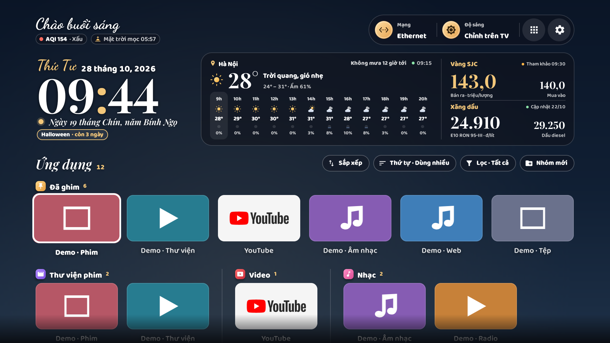
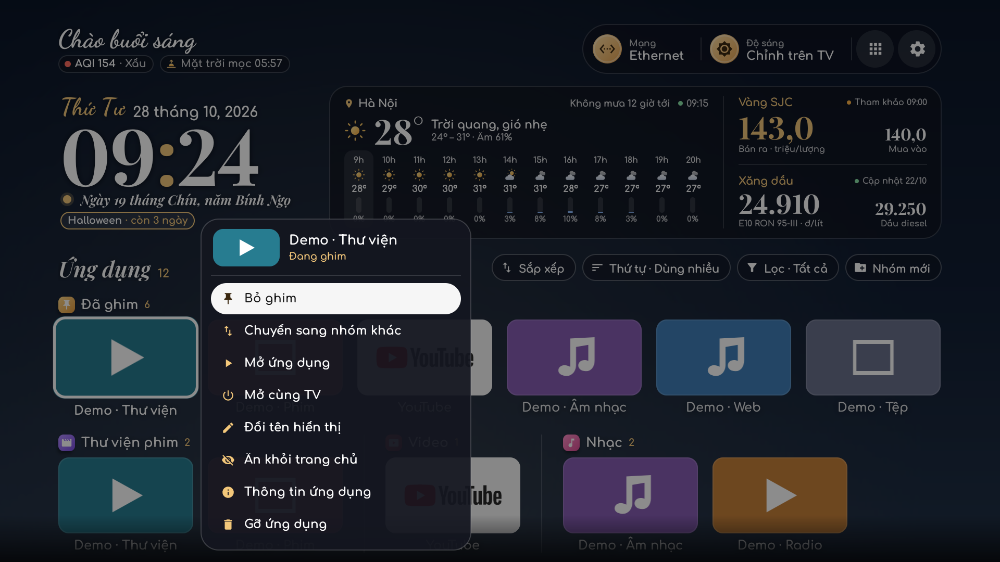
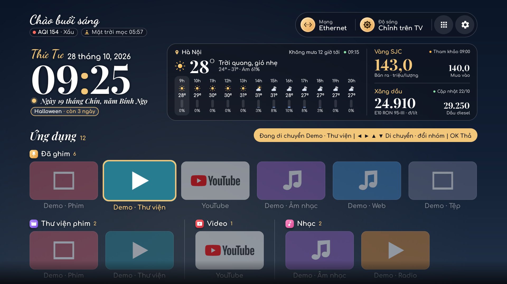
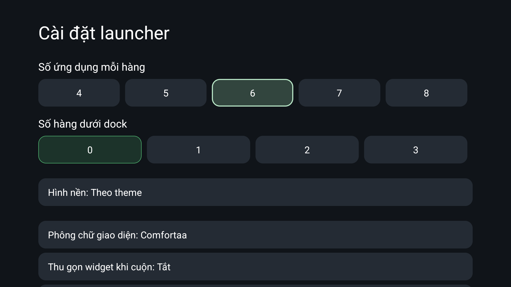
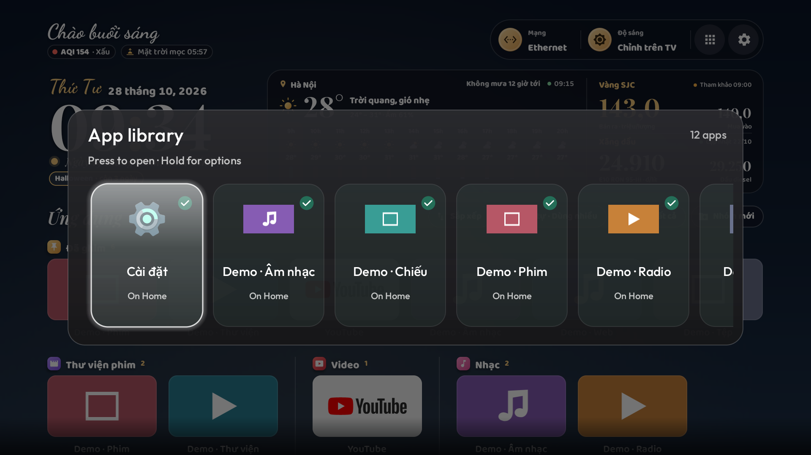
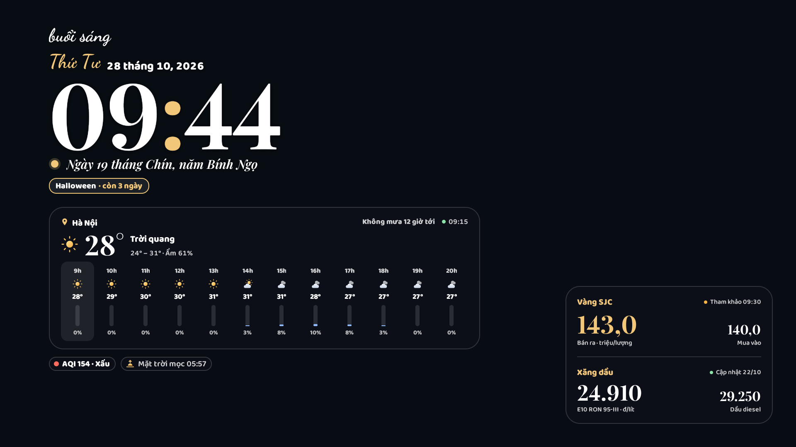
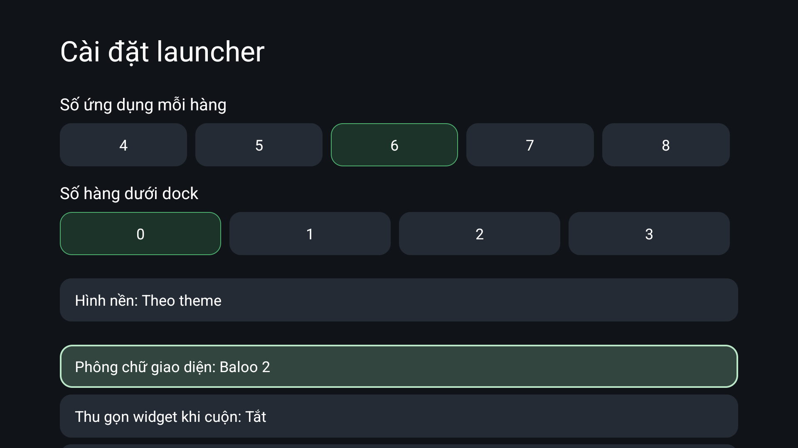

# Demo

Screenshots in this directory are captured from an Android emulator, not mockups. The device profile, build and any sample apps / data are recorded in SECURITY-REVIEW.md. Third-party services may be unavailable; no static number is presented as a live price. Screenshots are examples at their capture time.

Gallery: Home, app actions, reorder, launcher settings, clock / forecast and the app library. Physical HDMI, brightness hardware, boot-time Home handling and vendor screensavers require the real TV; screenshots cannot prove those features work on another model.

To reproduce: create a fresh 1080p Google TV AVD in Android Studio, build `assembleDebug`, install it on the explicit emulator serial, set Vietnamese locale, and load `themes/default/config.json` using `scripts/tv.sh`. Demo fixtures, if used, are generated by `demo/` and are separate packages installed only on that emulator; they are not bundled in the launcher APK.

Use D-pad / OK / Back, just as on a TV remote. To open the clock quickly, use a temporary config with `home_idle_clock_minutes:1`, return to Home and wait without input. Restore your normal config after capture. Never copy emulator session data or a private TV screenshot into the repo without checking it.

## Gallery

These are captures from the signed 1.0.0 release on the Google TV Android 14 emulator (1920×1080, 320 dpi). The gallery also shows the optional Baloo 2 interface font; the default is Comfortaa. Tiles prefixed **Demo** are sample apps; YouTube / Play Store / Live TV are emulator-installed apps, with their trademarks owned by the respective publishers. Their playback and account flows were not tested.

### Home: calendar, forecast, prices and pinned groups

### Hold OK: pin, group, rename, hide and Android uninstall prompt

### Reorder with D-pad: pick up, move, drop

### Launcher settings: columns, background, fonts and widget collapse

### App library

### Clock screensaver: time, lunar date, weather and markets

### Changing font with the remote

